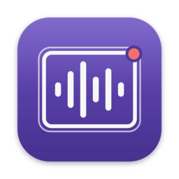
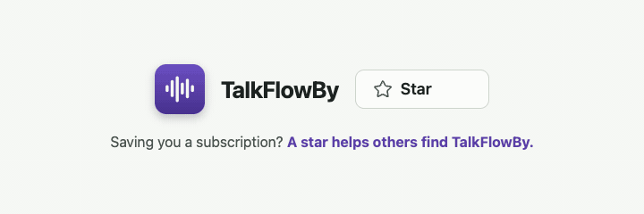
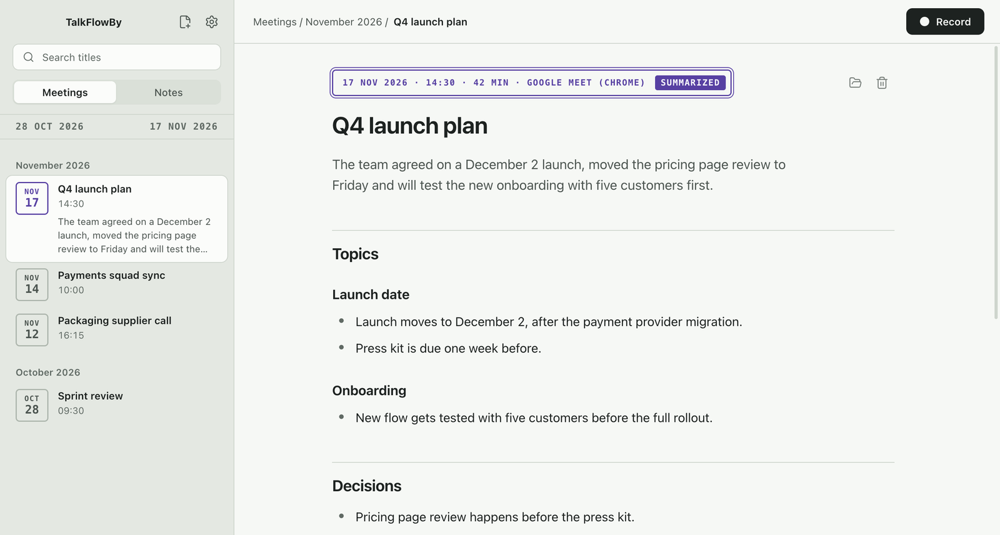
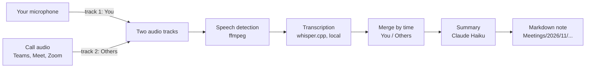
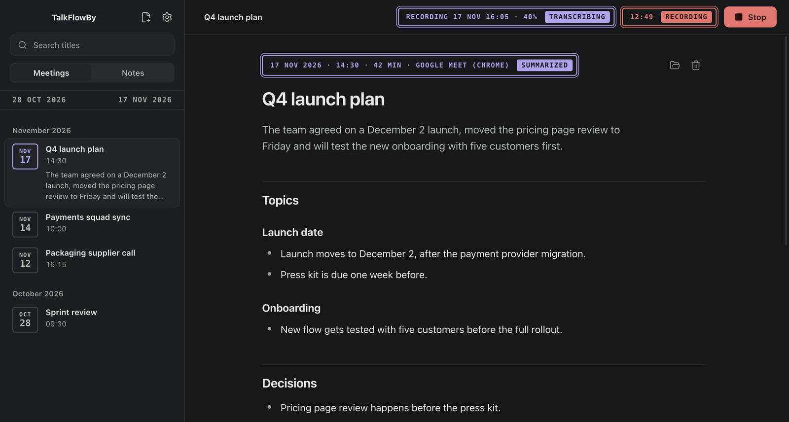
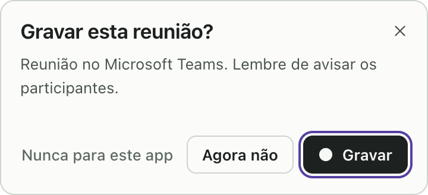

<div align="center">



# TalkFlowBy

**The free, open-source AI meeting notes app that records, transcribes and summarizes your calls on your own computer.**

Record both sides of your Teams or Google Meet call without a bot joining,
transcribe it on your own computer, and get a clean summary with decisions and next steps,
saved as a plain Markdown file you own.

A private alternative to **Notion AI Meeting Notes**, **Otter.ai**, **Fireflies**, **Granola** and other paid note takers.

[](https://github.com/ebrandes/TalkFlowBy/releases/latest)
[](https://github.com/ebrandes/TalkFlowBy/actions)
[](#download)
[](LICENSE)

<a href="https://www.buymeacoffee.com/ebrandes"></a>



</div>

---



## Why TalkFlowBy

Most AI meeting notes are a monthly subscription, send a bot into your call, and keep your
transcripts on someone else's server. TalkFlowBy does the useful part on your machine:

- **No bot in the call.** It records your microphone and your computer's audio, so nobody
  sees an extra participant.
- **Transcription stays local.** [whisper.cpp](https://github.com/ggml-org/whisper.cpp) runs
  on your computer. Audio never leaves it.
- **Summaries with your own Claude.** Claude Haiku turns the transcript into topics,
  decisions and next steps, using your existing Claude subscription (through Claude Code) or
  an Anthropic API key. No TalkFlowBy account, no TalkFlowBy server.
- **Plain Markdown files.** Every meeting is a readable `.md` file in a normal folder,
  organized by year and month. Open it in Obsidian, VS Code or any text editor.
- **A notepad too.** A simple block editor (type `/` for headings, lists and checkboxes) for
  meeting notes and free notes.
- **Asks at the right time.** When Teams or Google Meet starts using your microphone,
  a small prompt asks if you want to record. One click and it stays out of your way.
- **Stops by itself.** Recording ends when the call ends, or after a few minutes of silence
  (adjustable), so a forgotten recording never runs all day.
- **Never loses a recording.** If the app is closed mid-recording or mid-transcription, it
  picks up where it left off the next time it opens.
- **Send it to Claude.** One click copies the note or just the transcript, or opens Claude with
  the note ready to ask follow-up questions.
- **Clean up fast.** Select several meetings and move them to the Trash at once.

## Download

| System | File |
| --- | --- |
| macOS, Apple Silicon (M1 and newer) | `TalkFlowBy-x.y.z-mac-arm64.dmg` |
| macOS, Intel | `TalkFlowBy-x.y.z-mac-x64.dmg` |
| Windows 10 / 11 (64-bit) | `TalkFlowBy-x.y.z-windows-setup.exe` |

Get them from the [latest release](https://github.com/ebrandes/TalkFlowBy/releases/latest).

**First launch.** The installers are not signed yet, so the system warns you once:

- **macOS:** open the app, then go to *System Settings → Privacy & Security* and click
  *Open Anyway*. Or right-click the app and choose *Open*.
- **Windows:** on the SmartScreen warning, click *More info → Run anyway*.

On first launch TalkFlowBy offers to download the transcription model (about 574 MB, once).
On macOS it asks for two permissions: **Microphone** (your voice) and
**Screen & System Audio Recording** (macOS requires it to capture the call audio; no image
of your screen is recorded).

## How it works



1. **Record.** TalkFlowBy records two separate tracks: your microphone and the system audio
   (CoreAudio Tap on macOS, WASAPI loopback on Windows). Keeping them apart is how the
   transcript knows who said what, without guessing voices.
2. **Find the speech.** Silence is skipped before transcription, which keeps timestamps
   right and stops Whisper from inventing words in quiet parts.
3. **Transcribe locally.** `whisper.cpp` with the `large-v3-turbo` model runs on your CPU or
   GPU (Metal on Apple Silicon).
4. **Summarize.** The transcript text, never the audio, goes to Claude Haiku with a fixed
   structure: subject, short summary, topics, decisions and tasks.
5. **Write the note.** The app writes the Markdown itself from that structure, so every
   note has the same clean format. The file is named after the date, time and subject.

A note looks like this:

```markdown
---
date: 2026-11-17 14:30
duration: 42 min
source: Google Meet (Chrome)
---

# Q4 launch plan

> The team agreed on a December 2 launch and moved the pricing page review to Friday.

## Topics

### Launch date

- Launch moves to December 2, after the payment provider migration.

## Decisions

- Pricing page review happens before the press kit.

## Next steps

- [ ] Send the updated timeline to sales — Ana
- [ ] Prepare the press kit

## Transcript

**00:00 · You:** Let's start with the launch date...

**00:12 · Others:** The migration finishes on the 28th, so December 2 works.
```



<p align="center"></p>

## Requirements

- **macOS 14.2 or newer** (Apple Silicon or Intel), or **Windows 10/11 64-bit**.
- About 1 GB of free space for the app and the transcription model.
- For summaries, one of:
  - [Claude Code](https://github.com/anthropics/claude-code) installed and signed in
    with your Claude account (uses your subscription, no extra cost), or
  - an [Anthropic API key](https://console.anthropic.com/) (pay per use; a meeting costs cents).

  Without either, you still get the full transcript; only the summary is skipped.

## Privacy

- Audio is recorded and transcribed on your computer and deleted after the note is ready
  (you can choose to keep it).
- Only the transcript text is sent to Anthropic to write the summary, through Claude Code
  or your API key. Nothing else is sent anywhere, and there is no telemetry.
- Your API key is stored with the operating system's secure storage.
- Notes live in `Documents/TalkFlowBy`.

**Recording conversations can require everyone's consent where you live.** The meeting
prompt reminds you to tell the other participants.

## Good to know

- The interface is available in **English** and **Brazilian Portuguese**, picked from your
  system language and changeable in Settings. Notes, section titles and folder names follow
  the same choice. Transcription and summaries work in the language spoken in the meeting
  (English, Portuguese, Spanish, or automatic detection).
- Meeting detection recognizes Microsoft Teams, Zoom and Google Meet in Chrome, Edge,
  Safari, Arc, Firefox and Brave. You can always start a recording manually.
- Windows support is new. If something does not work on your machine, please
  [open an issue](https://github.com/ebrandes/TalkFlowBy/issues).

## FAQ

**Is TalkFlowBy a free alternative to Otter.ai, Fireflies, Granola or Notion AI Meeting Notes?**
It covers the core of what they do: record a meeting, transcribe it, and turn it into a
summary with decisions and action items. It is free and open source, runs on your computer,
and never sends a bot into your call. It does not offer cloud sync, team workspaces or
integrations.

**Does it work with Zoom, Microsoft Teams and Google Meet?**
Yes. It records your microphone and your computer's audio, so it works with any call app.
It also detects Teams, Zoom and Google Meet (in Chrome, Edge, Safari, Arc, Firefox and Brave)
and asks if you want to record.

**Does it work offline?**
Recording and transcription work fully offline. Only the summary step needs internet, to
reach Claude.

**Do I need to pay for anything?**
No subscription for TalkFlowBy. Summaries use your existing Claude subscription through
Claude Code, or an Anthropic API key billed per use.

**Where are my notes?**
In `Documents/TalkFlowBy`, as plain Markdown files organized by year and month. You can
open them with Obsidian, Logseq, VS Code or any editor.

## Build from source

```bash
git clone https://github.com/ebrandes/TalkFlowBy.git
cd TalkFlowBy
npm install
npm run build:micwatch   # macOS only: helper that detects meetings
npm run dev
```

To work on the interface only, with example data in the browser: `npm run dev:ui`.

On macOS, `whisper-cli` from Homebrew (`brew install whisper-cpp`) is used during
development. Installers:

```bash
npm run dist:mac -- --arm64   # or --x64; needs cmake and Xcode Command Line Tools
npm run dist:win              # run on Windows
```

Tests:

```bash
npm test
```

| Part | Where |
| --- | --- |
| Call audio capture | `src/main/capture.ts` |
| Two-track recording | `src/renderer/src/recorder.ts`, `src/main/recording.ts` |
| Speech detection and Whisper | `src/main/pipeline/chunks.ts`, `whisper.ts` |
| Summary (subscription or API key) | `src/main/pipeline/summarize.ts` |
| Markdown format | `src/main/pipeline/markdown.ts` |
| Meeting detection | `src/main/detector/`, `native/mac/micwatch.swift` |
| Design system | `DESIGN.md` |

Built with Electron, React, TypeScript, [Milkdown](https://milkdown.dev),
[whisper.cpp](https://github.com/ggml-org/whisper.cpp), ffmpeg and
[Lucide](https://lucide.dev) icons.

## Support the project

If TalkFlowBy saves you a subscription, a ⭐ on GitHub helps other people find it, and a
coffee keeps it going.

<a href="https://www.buymeacoffee.com/ebrandes"></a>

## License

[MIT](LICENSE)
